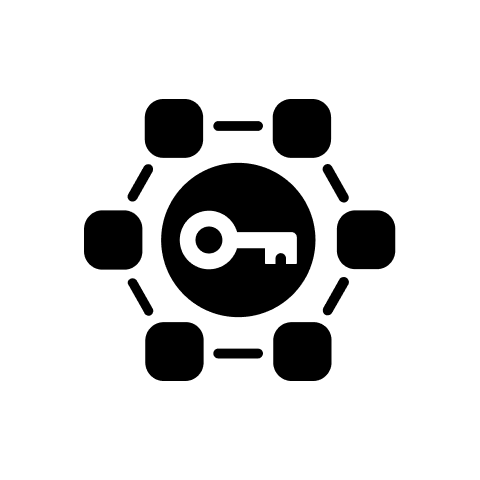

<p align="center">
 
 <h1 align="center">Giano</h1>
</p>

**Giano** is an ERC-4337-compliant smart wallet based on the [Coinbase Smart Wallet](https://github.com/coinbase/smart-wallet).

## Architecture at a glance

Giano is primarily a hosted, multi-tenant service owned and run by Applied Blockchain: one
deployment serves many client applications (tenants), each with its own passkey domain (`RP_ID`),
allowed origins, admin key and paymaster balance. The same versioned artifacts below can also be
deployed on-premise, into a stack the client controls; that path is supported but no client has
used it yet.

- **Packages** (npm, GitHub Packages): `giano-contracts` (ABIs + address registry), `giano-wallet-core` (provider, passkey smart account, injection seam), `giano-wallet-transport` (popup protocol), `giano-connector` (the thin dApp SDK).
- **Services** (Docker images, GHCR): `giano-wallet-api` (Fastify + Postgres: WebAuthn ceremonies, sessions, policied userop relay), `giano-wallet-web` (the dedicated wallet origin — passkey ceremonies + consent UI), `giano-bundler`, `giano-devnet`, `giano-contracts-deployer`.

A dApp integrates only `giano-connector` + a wallet URL; all wallet trust lives on the wallet origin.

## Prerequisites

- **Node 22.18 or later** and **pnpm** (`corepack enable`). The repo typechecks with TypeScript 7 —
  see [TypeScript toolchain](#typescript-toolchain).
  The E2E demo needs **Node 24**, because [portless](https://github.com/vercel-labs/portless) — which
  serves the demo's `*.localhost` addresses — requires it.
- **Docker** (Compose) — for the local stacks, wallet-api integration tests, and E2E.
- **`docker login dhi.io`** — every image builds on a [Docker Hardened Image](docs/abip-compliance.md)
  (ABIP-2), and `dhi.io` refuses anonymous pulls. Log in once with a Docker Hub account, which can be free; an
  account created through Google or GitHub sign-in has no password, so use a personal access token
  (Docker Hub → Account settings → Personal access tokens, read-only) as the password.
- **A GitHub token with `read:packages`** in `~/.npmrc` — only for the example app
  (`services/custom-example`). It is its own pnpm workspace, outside the repo's, and installs the
  published `@appliedblockchain/giano-connector` from GitHub Packages, which refuses anonymous reads:
  `//npm.pkg.github.com/:_authToken=<token>` (`gh auth token` works once `gh auth refresh -s read:packages`
  has added the scope), then `pnpm -C services/custom-example install`. Building the `giano-example`
  image takes the same token as a secret: `GITHUB_TOKEN=<token> docker compose … build`.
- **Foundry** (`curl -L https://foundry.paradigm.xyz | bash`) and **git submodules** (`pnpm git:init`) — only needed to compile contracts or run `forge test`; the published-package build path needs neither.

```sh
pnpm install
```

## Running everything locally

### Option A — full stack in Docker (recommended)

The E2E compose stack brings up the **entire system** with contracts pre-deployed into an
instant-boot devnet (EntryPoint v0.7 + Giano factory + testing paymaster baked into the anvil
state), so there is nothing to deploy by hand:

```sh
# --profile portless adds the container that lends the stack port 80
docker compose --profile portless -f deploy/docker-compose.e2e.yml up --build

# register the names, then wait until they answer
pnpm -F @appliedblockchain/giano-e2e portless:up
```

Addresses are names, not ports. [portless](https://github.com/vercel-labs/portless) maps each
`*.localhost` name to the loopback port behind it; `e2e/origins.mjs` is the name/port table and
the single source of truth the fixtures, the tenant seed and the tests all read.

None of it runs as root. A URL with no port *is* port 80, and macOS and Linux reserve ports
below 1024 for root — so rather than `sudo portless proxy start`, the `portless-port80`
container holds port 80 (Docker already binds this stack's host ports through its own
privileged helper) and relays it to portless listening unprivileged on 1355. `/etc/hosts` is
left alone as well. If you would rather run the proxy on port 80 directly,
`sudo pnpm -F @appliedblockchain/giano-e2e portless:proxy` does that and the container is then
unnecessary.

| Service | URL | Notes |
| --- | --- | --- |
| devnet A (anvil) | http://rpc.localhost | chain 31337, contracts pre-deployed |
| bundler A (alto) | http://bundler.localhost | EntryPoint v0.7 |
| devnet B (anvil) | http://rpc-b.localhost | chain 31338 — same contracts at the SAME addresses (the stack is two-chain by default; see `e2e/README.md`) |
| bundler B (alto) | http://bundler-b.localhost | chain B's own submission infrastructure |
| wallet-api | http://api.localhost | serves both chains; also reached via the wallet-web `/api` proxy |
| wallet-web | http://wallet.localhost | the wallet origin, serving both chains (open it directly for the Settings view) |
| paymaster admin | http://paymaster.localhost | operator console: tenant balances, treasury, roles, health |

`*.localhost` hosts resolve to `127.0.0.1` automatically. Point a dApp at
`http://wallet.localhost` as the wallet URL; the stack already allow-lists the demo dApp
origin (`http://app.localhost`).

Tear down with `docker compose --profile portless -f deploy/docker-compose.e2e.yml down`, and
drop the names with `pnpm -F @appliedblockchain/giano-e2e portless:down`. HTTP rather than
portless's default HTTPS is deliberate: `http://*.localhost` is already a secure context, so
passkeys work without minting and trusting a local CA.

### Which dApp goes in front of it

Two dApps in this repo can sit on `http://app.localhost`, and it is worth knowing which is
which — they are not interchangeable:

| | What it is | When to use it |
| --- | --- | --- |
| **The example app**<br>`services/custom-example` | A real UI — Vite + React + Chakra UI: wallet basics, an ERC-20 panel, a gasless-sponsorship panel. | **This is the one to run.** Whenever you want to *use* Giano, show it to someone, or poke at a change by hand. See [Option C](#option-c--the-example-app). |
| **The demo fixture**<br>`e2e/dapp` | Deliberately barebones: one static HTML page, no framework, stable element ids and nothing else. | Mostly just a Playwright target. The E2E suite starts it itself, so you rarely run it by hand — only to debug a failing test. |

They share the one origin, so **only one of them can run at a time**: `http://app.localhost` is
port 4400 behind portless, and 4400/4401 are the only dApp origins the E2E tenants allow-list.

```sh
pnpm demo:dev                                  # the example app — start here
pnpm --filter @appliedblockchain/giano-e2e dapp # the barebones test fixture
```

### Option B — iterate on wallet-api against a fresh devnet

`deploy/docker-compose.dev.yml` runs Postgres + a fresh anvil + alto + wallet-api (built from
source). The chain starts empty, so deploy the contracts first and pass the factory address:

```sh
# 1. start a local anvil (or use the compose one) and deploy Giano contracts
pnpm local:node                   # anvil on :8545 (separate terminal)
pnpm local:deploy                 # CreateX, EntryPoint, P-256 verifier, factory, paymaster, fixtures

# 2. bring up the API stack, pointing it at the factory (its canonical address, on every chain)
FACTORY_ADDRESS=$(pnpm -s --filter @appliedblockchain/giano-contracts deploy:cli addresses | awk '/factory /{print $2}') \
  docker compose -f deploy/docker-compose.dev.yml up --build
```

Swagger UI is available at the wallet-api's `/docs` outside production.

### Option C — the example app

**`services/custom-example` is the app to run when you want to see Giano working.** It is a
Vite + React + Chakra UI dApp with a real UI, and it demonstrates the thin two-origin
integration — the same model as the barebones E2E fixture, but built to be used rather than
asserted against:

- **wallet basics** — connect / disconnect, send a user-operation, `personal_sign` and
  `eth_signTypedData_v4`;
- **an ERC-20 panel** — read a token's metadata and balance, transfer, approve, and sign an
  EIP-2612 permit (tokens without permit support are reported cleanly);
- **a gasless-sponsorship panel** — every send goes through Giano's paymaster, and because the
  wallet origin runs its ERC-7677 sponsorship check *before* asking for a passkey, a
  "call an unlisted contract" action is refused up front: no consent prompt, no passkey, nothing
  charged.

Bring up the Option A stack, then:

```sh
pnpm demo:dev   # http://app.localhost
```

(The root scripts are named `demo:*` for historical reasons — `pnpm demo:dev` runs the example
app, not the `e2e/dapp` fixture.)

It defaults to the Option A stack (wallet origin `http://wallet.localhost`, anvil RPC
`http://rpc.localhost`, chain 31337, devnet test token prefilled). Override with `VITE_WALLET_URL`,
`VITE_RPC_URL`, `VITE_CHAIN_ID`, `VITE_TEST_ERC20` for other networks.

**Two tenants side by side.** The E2E stack seeds two tenants against one backend, each with its
own wallet origin, and this one app serves both:

```sh
pnpm demo:stock                                      # http://app.localhost     -> wallet.localhost
pnpm demo:byo                                        # http://app-byo.localhost -> wallet-byo.localhost
pnpm -F @appliedblockchain/giano-e2e wallet-byo       # tenant byo's wallet origin (needed for demo:byo)
```

Stop these dev servers before running the E2E suite — see [Running the tests](#running-the-tests).

## Running the tests

```sh
# typecheck every package and service with TypeScript 7 (build the packages first: dependants
# resolve each other's dist/ types)
pnpm build && pnpm typecheck

# package unit tests (no Docker)
pnpm --filter @appliedblockchain/giano-wallet-core test        # signing, fee precedence
pnpm --filter @appliedblockchain/giano-wallet-transport test   # popup protocol, origin pinning

# wallet-api integration tests (spins up Postgres via testcontainers — needs Docker)
pnpm --filter @appliedblockchain/giano-wallet-api test

# contract tests (needs Foundry + submodules)
forge test    # from packages/contracts

# end-to-end (four real origins, Chromium + virtual authenticator)
# --profile portless adds the container that lends the stack port 80, so the demo's
# addresses are names rather than ports — see e2e/README.md
docker compose --profile portless -f deploy/docker-compose.e2e.yml up --build -d --wait
pnpm --filter @appliedblockchain/giano-e2e exec playwright install chromium
pnpm --filter @appliedblockchain/giano-e2e test
```

`pnpm test` registers the portless routes and starts the dApp/wallet fixtures itself (Playwright
`globalSetup`), so the compose stack above is the only prerequisite.

The dApp the suite drives is the barebones `e2e/dapp` fixture, not the example app — that is what
the fixture is *for*: one static page with stable element ids and no framework to get in the way.

> **Stop `pnpm demo:*` before running the suite.** The example app and the fixture compete for
> ports 4400/4401, and Playwright's `reuseExistingServer: true` will silently adopt the example
> app instead of the fixture — every test then fails on a missing `#connect`.

The E2E suite drives the full flow — create wallet, connect, session resume, send a sponsored
transaction through consent to a receipt, reject (4001), sign message / typed data, hostile-origin
rejection, ROR well-known, and the popup-blocked path.

## Security note: committed bundler API keys

Earlier versions of `services/custom-example` committed `.env-*` files containing Coinbase
Developer Platform bundler RPC URLs whose path segment is an API key. Those files have been
removed (the thin-SDK demo needs no bundler URL), but **the keys remain in git history and must be
rotated** (ops task) — treat them as public.

## Releasing

The six publishable packages — `giano-contracts`, `giano-wallet-transport`, `giano-wallet-core`,
`giano-connector`, `giano-wallet-kit`, `giano-paymaster-sdk` — go to GitHub Packages
(`https://npm.pkg.github.com`) under one shared version. Everything under `services/` and `e2e/` is
private and never published.

**Merging the version pull request publishes.** Every merge to `main` that carries a changeset opens
or updates `changeset-release/main`, titled *chore: version packages*, holding the bump for all six
plus their CHANGELOGs. Cutting a release is merging it — nothing to run locally, no tag to push:

```fish
gh pr list --head changeset-release/main
```

That merge leaves `main` with no changesets pending, so the Release workflow publishes `3.0.0` for
all six under `latest`, pushes a `v3.0.0` tag, and builds container images at it — one Giano version
across packages and images. A published tarball pins its Giano siblings to that exact version, so
installing one of the six installs that release rather than a resolution across two.

Every other merge to `main` runs CI and Determinism and publishes nothing. There is no prerelease
line and nothing installable between releases; a consumer who needs the tip of `main` builds from
source.

The version pull request carries no checks. A pull request opened by a workflow using the default
token starts no further workflow runs, so its branch never gets a CI run; the gate that matters runs
after the merge, and nothing publishes that CI and Determinism have not passed at that commit.

### Working with changesets

- A pull request that changes publishable source under `packages/` must carry a changeset; CI fails
  it otherwise. Add one with `pnpm changeset`. A pull request touching only `package.json` and
  `CHANGELOG.md` there — which is what the version pull request is — is exempt.
- For a change that should release nothing — a comment, a test, a build tweak — use
  `pnpm changeset --empty`.
- A single changeset may not name both a publishable package and an ignored one (the four services
  and `e2e`); Changesets rejects a mixed changeset. Write two.
- The six publishable packages are in a `fixed` group: bumping one bumps all of them to the same
  version.

### A published version is permanent

Neither GitHub Packages nor npmjs lets a version be replaced, and deleting a version to republish
it breaks every lockfile that already resolved it. A broken release is superseded by a new version,
never by re-publishing the same number.

## Deploying Giano (for client projects)

> **New to Giano? Start with [`specs/DEVELOPER-GUIDE.md`](specs/DEVELOPER-GUIDE.md)** — a single
> self-contained guide covering dApp integration, standing up the stack on any EVM chain, the
> `giano-doctor` verification CLI, and a production checklist, with explicit software/keys/secrets/
> infrastructure dependencies.

- `deploy/docker-compose.reference.yml` — the reference stack (postgres + wallet-api + wallet-web)
  with a fully commented env matrix to copy into your own deployment.
- `deploy/helm/giano` — Helm chart (wallet-api + migrations hook, wallet-web, optional bundler,
  contracts-deployer pre-install Job, ingress).
- `specs/INTEGRATION.md` — DNS/TLS, proxy rules, the COOP caveat, per-container env, and the
  upgrade runbook. `COMPATIBILITY.md` — versioning and upgrade order. The secrets inventory and the
  metrics to watch them by are in `specs/DEVELOPER-GUIDE.md` §2.2 and §6.
- `specs/PAYMASTER-REQUIREMENTS.md` and `specs/PAYMASTER-SPECS.md` — gas sponsorship: what it must
  do and why the decisions were made, and the technical design that implements it.

### Important tips

- Run `pnpm build` (or `pnpm build:connector`) after changing the contracts or packages so
  dependents pick up the changes.
- Contracts deploy with CREATE3 through CreateX from a committed **release**, so every canonical
  address is a function of the canonical deployer and a fixed label only: identical on every chain,
  whatever the bytecode. To run unreleased contract changes locally, restart anvil and deploy the
  working tree: `pnpm deploy:cli core --rpc http://127.0.0.1:8545 --impersonate --release dev
  --role-admin <0x…>` (from `packages/contracts`). Deployed addresses come from the committed
  registry in `@appliedblockchain/giano-contracts` (`addresses.ts`, built from
  `deployments/<chainId>.json`); the CI `determinism` job fails if a release does not reproduce or
  the canonical addresses or code drift. See `packages/contracts/README.md`.

## Troubleshooting

### The demo's `*.localhost` addresses do not answer

The E2E demo is addressed by name rather than by port, via a local portless proxy. If
`http://app.localhost` and friends fail:

- a portless **404** means the routes are not registered — `pnpm -F @appliedblockchain/giano-e2e portless:up`;
- a **502** means the route is registered but nothing is behind it — the compose stack or a host
  fixture is down;
- *connection refused* means nothing holds port 80 — bring up the relay with
  `docker compose --profile portless -f deploy/docker-compose.e2e.yml up -d portless-port80`.

`pnpm -F @appliedblockchain/giano-e2e portless:list` shows the active routes and `portless doctor`
checks proxy, routes, DNS and trust in one go. Full reference: [`e2e/README.md`](./e2e/README.md).

### Heap out of memory

The build no longer needs a bigger Node heap. The old `NODE_OPTIONS='--max-old-space-size=16384'`
workaround predates the TypeScript 7 port: measured on an M2 Pro (Oct 2026), the largest single
process in a full `pnpm build` peaks at about 1.5 GB, and `pnpm typecheck` at under 1 GB. If you
still hit the limit, report it with the command that failed.

## TypeScript toolchain

Every package typechecks with **TypeScript 7** (the native compiler): `pnpm typecheck` runs `tsc
--noEmit` in each package and service. `services/custom-example` is its own pnpm workspace, so run
`pnpm typecheck` inside it (its `build` and Docker image run it too). Each package installs two aliases
([Microsoft's documented setup](https://devblogs.microsoft.com/typescript/announcing-typescript-7-0/)):

| Alias | Resolves to | Used by |
| --- | --- | --- |
| `@typescript/native` | `typescript@7` | the `tsc` binary: `typecheck` scripts, `build` scripts that run `tsc --noEmit`, CI |
| `typescript` | `@typescript/typescript6` (6.0 API, `tsc6` binary) | tools that `import 'typescript'` as a library |

TypeScript 7.0 has no programmatic API (it is planned for 7.1). One tool still needs one, so it
stays on the 6.0 API until it supports 7.1's:

| Tool | Why it needs the API | Moves to TS 7 when |
| --- | --- | --- |
| typescript-eslint (`services/custom-example` lint) | the parser and type-aware rules use the API | typescript-eslint supports TS 7, or the lint moves to oxlint |

**Builds use no compiler API.** Every package and service builds with [tsdown](https://tsdown.dev)
(tsup is no longer maintained and points there). Declarations come from tsdown's `oxc` generator,
which emits each `.d.ts` from its source file alone (`isolatedDeclarations`): every export must carry
explicit types, and one that does not **fails the build** with a TS9xxx error. `tsc --noEmit
--isolatedDeclarations` in a package lists every such site at once. vite, vitest and tsx transpile
without the compiler too.

The `@typescript/typescript6` alias can only be dropped from **every package at once**. viem (and
abitype) declare `typescript` as a peer, so pnpm installs one viem copy per TypeScript a package
resolves; a package on plain `typescript@7` gets a different viem than one on the alias, and viem
types passed between the two stop being assignable.

**Consumers** of the published packages need **TypeScript 5.0.4 or later** (the same floor as
viem). The declarations are checked with 5.0.4, 5.5, 6.0 and 7.0.

**Editor:** VS Code's built-in TypeScript is not TS 7 yet. Install the
**TypeScript (Native Preview)** extension (`TypeScriptTeam.native-preview`); once installed it is
the default, and the command palette's
"Disable TypeScript 7 Language Server" switches back.

## Components

**Contracts** (`packages/contracts`)

- `GianoSmartWallet` — the smart account: validates passkey/ECDSA signatures and executes calls.
- `GianoSmartWalletFactory` — CREATE2 factory; `getAddress(owners, nonce)` is the counterfactual address.
- `MultiOwnable` — owner set, where each owner is a P-256 passkey or an ECDSA address.

**Wallet origin** (`services/wallet-web` + `packages/wallet-core`)

- `wallet-core/provider.ts` — the EIP-1193 provider that repackages transactions as ERC-4337
  user operations. It runs **on the wallet origin**, never in a dApp bundle.
- `wallet-core/account/toGianoSmartAccount.ts` — viem smart-account instance for the wallet.
- `wallet-core/provider-injection` — the seam between the provider and its backend;
  `createWalletApiInjection` binds it to `giano-wallet-api`.

**dApp SDK** (`packages/connector` + `packages/wallet-transport`)

- `thin/create-giano-wallet-provider.ts` — `createGianoWalletProvider`, the only provider a dApp
  needs; reads are answered locally, wallet actions go over the popup transport.
- `connector.ts` / `gianoWallet.ts` — wagmi connector and RainbowKit wallet built on top of it.
